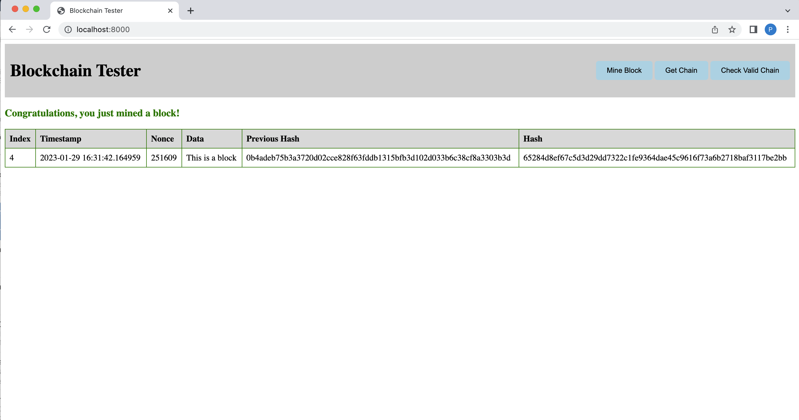
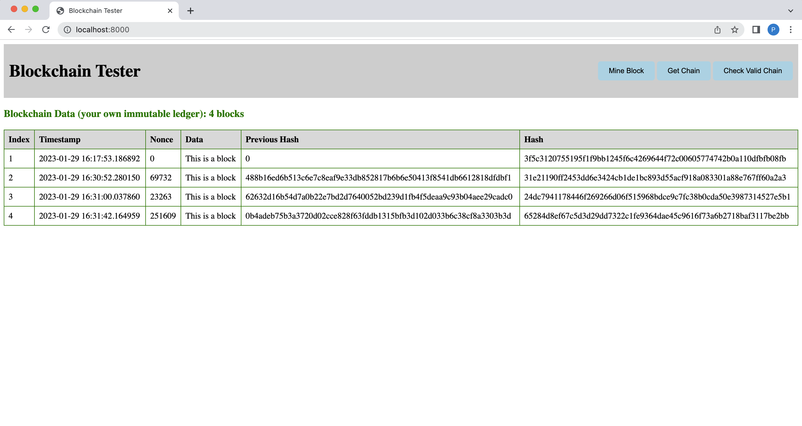
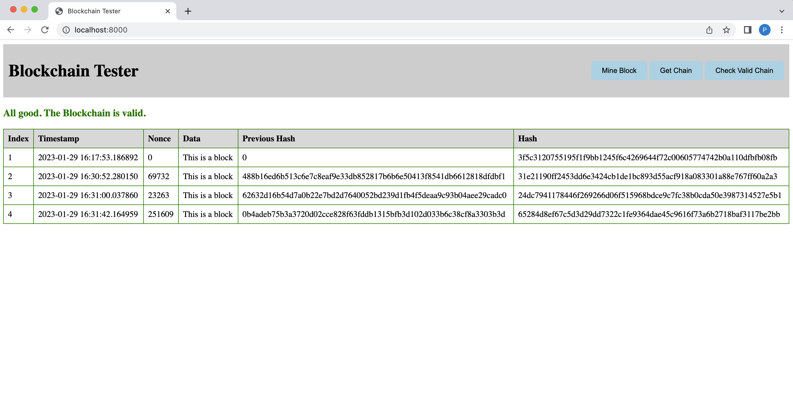

A very simple implementation of blockchain and its applications in Python.

- [Blockchain](#blockchain)
- [Cryptocurrency](#cryptocurrency)
- [Smart Contracts](#smart-contracts)

### Blockchain
To use the base functionality of the blockchain, you can use the `Blockchain` class. It has the following methods:
- `new_block`: Adds a block to the blockchain.
- `hash`: Hashes a block.
- `proof_of_work`: Simple Proof of Work Algorithm:
    - Find a number p' such that hash(pp') contains leading 4 zeroes, where p is the previous p', p is the previous nonce, and p' is the new nonce.
    - The number of leading zeroes can be changed by changing the `difficulty` variable.
    - The `proof_of_work` method returns the nonce that satisfies the above condition.
    - The `new_block` method calls the `proof_of_work` method to get the correct nonce for the new block.
- `check_valid_nonce`: Checks if the nonce satisfies the proof of work condition.
- `check_valid_chain`: Determines if a given blockchain is valid.

I also add a REST API server to serving these above functions. The API has the following endpoints:
- `/mine-block`: Mines a new block.
- `/get-chain`: Returns the full blockchain.
- `/is-valid`: Checks if the blockchain is valid.

In order to try out the demo, you can run the following commands:
```bash
# Install FastAPI and uvicorn
$ pip install fastapi uvicorn

# Run the server
$ uvicorn blockchain:app
```
Now, navigate to `http://localhost:8000/` to have a look at the demo page and `http://localhost:8000/docs` for the detail
documentations. The app behaviors should be like the following:
<figcaption align="center">Figure 1: Mine a block</figcaption>



<figcaption align="center">Figure 2: Get the blockchain</figcaption>



<figcaption align="center">Figure 3: Check if the blockchain is valid</figcaption>



Developed by [Duy Huynh](https://duy-huynh.com/), 2023.
## DeeCoin: transactions and local peer consensus

The continuation of [Blockchain #01](https://blog.duy.dev/giai-ngo-blockchain-demo-don-gian-voi-python/)
adds the transaction and peer-consensus exercises promised by the original article.
`blockchain.py` remains the original Part 1 demo. `deecoin.py` now uses the separate,
testable `ledger.py` and `peers.py` modules. Its previous unsigned, float-valued
transaction API and browser form are superseded by the signed API below; `/docs`
is the supported interactive interface.

This is an **in-memory, localhost learning exercise**, not a cryptocurrency to use
with real funds. It has no durable storage, automatic gossip, fee market, difficulty
adjustment, finality guarantee, or public-network defenses. Start one worker per
node. Restarting it loses its chain and pending transactions. The old template is
retained as historical material and is no longer served by the DeeCoin app.

### Install and reproduce

Use Python 3.12 and the tested dependency snapshot:

```bash
python -m venv .venv
source .venv/bin/activate
pip install -r requirements-lock.txt
python -m unittest discover -s tests -v
python -m examples.transactions
```

The transaction example generates ephemeral Ed25519 keys without printing private
keys. Alice mines 10 integer units, sends Bob 3 with nonce 1, and Bob mines the
containing block and earns another 10: balances become Alice 7 and Bob 13.
`requirements.txt` records the supported direct dependency ranges;
`requirements-lock.txt` records the exact environment used for the tests.

### Ledger rules

- Addresses are lowercase hex-encoded 32-byte Ed25519 public keys. Signatures are
  hex-encoded 64-byte values over canonical JSON of `sender`, `recipient`,
  `amount`, and `nonce`; use `ledger.signing_bytes`, not arbitrary JSON formatting.
- Amounts are positive integer units. Floats, booleans, zero, negative values,
  unknown fields, invalid signatures, insufficient balances, and replayed or
  skipped sender nonces are rejected. Nonces start at 1 and increase by one.
- The pending pool replays its transactions after confirmed state, reserving funds
  and nonces. Pending incoming funds can be spent later in the same ordered pool;
  they are not final and may disappear on a reorganization.
- Every non-genesis block ends with exactly one reward of 10 units. The reward
  cannot be spent earlier in its own block. Only this reward increases supply.
- Genesis is identical on every node. Every later block's proof covers its full
  content and previous hash; only the stored `hash` is excluded. Difficulty is
  fixed at two leading hex zeroes so the exercise runs quickly.
- A candidate must pass complete genesis, shape, hash, proof, height, link,
  timestamp, signature, nonce, balance, and reward checks before adoption. At this
  fixed difficulty only, more valid blocks represent greater expected work.
  Equal-length forks keep the local tip until a valid longer branch arrives.
- A reorganization recomputes balances and sender nonces from the winning chain.
  Orphaned and pending transfers are reconsidered in order; already mined,
  conflicting, or newly unaffordable ones are dropped. Reinserted transfers remain
  pending, not confirmed.

### HTTP API

Start nodes in separate terminals, bound only to loopback:

```bash
uvicorn deecoin:app --host 127.0.0.1 --port 8000 --workers 1
uvicorn deecoin:app --host 127.0.0.1 --port 8001 --workers 1
```

From a third terminal, run `python -m examples.two_nodes` against fresh nodes. It
mines and transfers on port 8000, registers it as a peer of port 8001, synchronizes,
and checks that both chains and balances agree. Open `http://127.0.0.1:8000/docs`
for request schemas. The client keeps private keys locally; the API receives only
public addresses and signatures.

| Method and path | Purpose |
| --- | --- |
| `POST /mine_block` | Mine pending transfers with body `{"recipient":"<public-key hex>"}` |
| `POST /add_transaction` | Submit `sender`, `recipient`, integer `amount`, integer `nonce`, `signature` |
| `GET /balance/{address}` | Confirmed balance, projected pending balance, next sender nonce |
| `GET /get_chain` | Full chain and actual length including genesis |
| `GET /is_valid` | Replay and validate the local chain |
| `POST /connect_node` | Explicit one-way registration, e.g. `{"address":["http://127.0.0.1:8000"]}` |
| `GET /list_nodes` | Registered peer origins |
| `POST /replace_chain` | Query peers and adopt a strictly longer fully valid chain |

Peer registration accepts only HTTP loopback origins with explicit ports and never
recursively broadcasts. Fetches refuse redirects, use a two-second socket timeout,
and cap the response at 2 MiB. Peer-provided `length` is ignored. Invalid/offline
peers are reported without preventing checks of other peers. Limits are 16 peers,
100 pending transactions, and 1,000 blocks; they deliberately bound this exercise
and are not a scalable networking design. The timeout is an I/O timeout, not a
hard total request deadline against a slow-drip hostile server.
The byte limit and block limit are independent: a dense but valid chain can
exceed 2 MiB before reaching 1,000 blocks and will then be refused by the fetcher.
Pagination and a coordinated wire-size budget are deliberately outside this demo.

### What the tests establish

The suite exercises integer/accounting rules, signature tampering, sender
impersonation, nonce replay, pending and concurrent double spends, forged rewards,
invalid full-block proofs, malformed genesis and chains, equal-length forks,
valid-chain adoption, orphan reinsertion, stale-pool removal, peer failures,
transport limits, and end-to-end API balance behavior. These checks demonstrate
specific invariants. They do not establish production security, Sybil resistance,
network liveness, or irreversible settlement. A low-difficulty attacker can simply
remine a valid alternative history; signatures cannot prevent a signed double
spend on competing forks. Separate copies of this same demo also share the same
signature domain, so keys and transactions should not be reused across projects.
